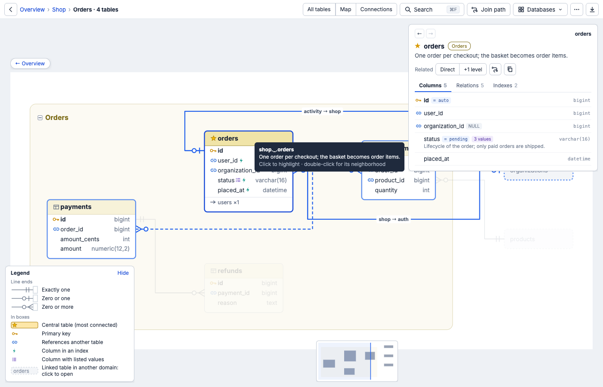
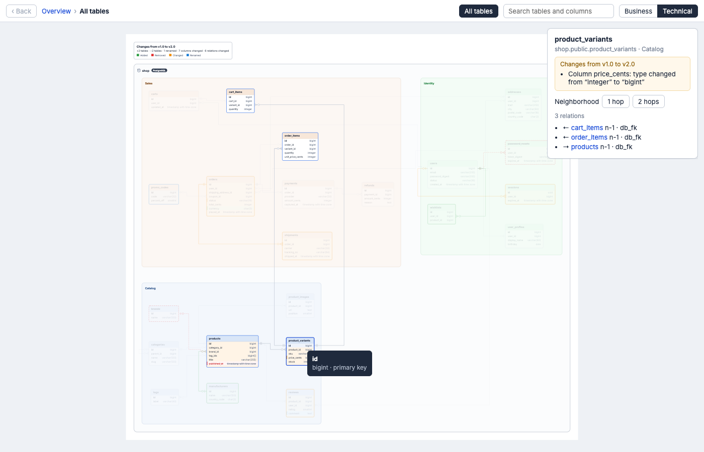
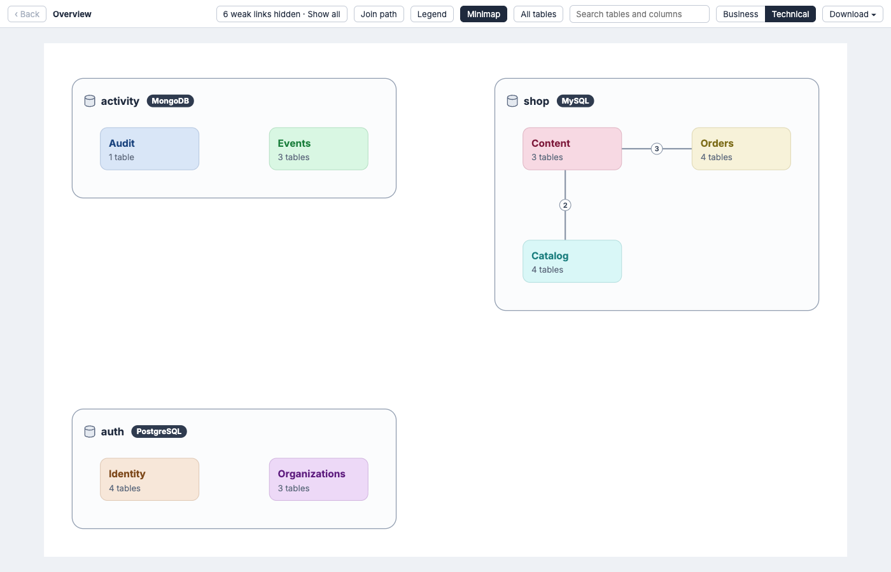

# open-erd

Interactive ERDs generated from your project's source code — for projects whose
schema has no foreign keys, uses polymorphic associations, or spans several
databases.

A Claude Code plugin. Claude reads the code (and, only if you allow it, database
metadata) and writes a reviewable YAML **model**. Plain deterministic code turns
that model into the diagram: the same model always produces byte-identical
files.



## What you get

| File | What it is |
|---|---|
| `out/erd.svg` | One self-contained file. Overview (database → domain), domain views, neighborhood of a table. Click a table to highlight its links, click a line to animate it, search tables/columns, hover a column for type/enum meanings/notes, Business/Technical mode. Without JavaScript it still shows the static overview. |
| `out/erd.xlsx` | Overview sheet first, then Tables, Columns, Relations, Enums, Polymorphic and a "To review" checklist, cross-linked. |
| `out/diff.svg`, `out/diff.xlsx` | What changed between two snapshots, colored on the diagram and written as plain sentences, plus a Changes sheet. |



Readability with 100+ tables: three zoom levels (overview / domain / neighborhood),
shared columns such as `created_by` shown as badges instead of lines,
polymorphic associations drawn as one node, cross-database and inferred
relations dashed with their evidence (`repo:path#symbol`). Adding tables keeps
the existing layout's relative order, so people who know the diagram still
recognise it.



## Install

Requires Claude Code and Node.js 20 or later.

```
/plugin marketplace add TOMOSIA-VIETNAM/open-erd
/plugin install open-erd@open-erd
```

## Use

| Command | Does |
|---|---|
| `/open-erd:init` | Asks where to put the ERD workspace (outside your code repo, its own git repo), writes a read-only extract script per source repo and runs it after you approve, proposes domains, draws the first ERD. |
| `/open-erd:sync` | Re-reads the code, updates the model, asks you to confirm renames, marks facts that no longer match as `stale` instead of deleting them, commits. |
| `/open-erd:review` | Walks through inferred and stale relations one by one; you confirm or correct in plain words. Reviewed facts are locked. |
| `/open-erd:render` | Re-renders the outputs; `--profile public` drops evidence, PII columns, internal notes and hidden tables for sharing outside the team. |
| `/open-erd:snapshot` | Tags the workspace (e.g. `v1.0-handover`). |
| `/open-erd:diff` | Compares two snapshots (or a snapshot and the current state). |
| `/open-erd:feedback <text>` | Opens a GitHub issue on this repository with your feedback, after showing you the draft. Never attaches your project's data. |

To change the diagram, just say it: "orders.status: refunded means money
returned", "move Billing next to Orders", "invoices.user_id points to
customers, not users".

## Safety

- Nothing is written to your source repositories; extract scripts only read files and never boot your app.
- Database access happens only when you approve it each time, read-only, metadata only; credentials are never stored.
- The workspace is never pushed unless you ask.

## Supported sources

Rails, Laravel, Django, Prisma, TypeORM, Sequelize, Mongoose and raw SQL are
covered by the extraction guide; other stacks work through the same
read-only-script approach. Several repositories and several databases (SQL and
MongoDB) can share one ERD.

## Development

```
cd engine
npm ci
npm test              # unit, geometry, stability and determinism tests
npm run test:large    # 1000-table and 500-tenant scale tests
npm run build         # bundles the engine to dist/open-erd.mjs (committed)
npm run eval          # runs Claude headless on every fixture and scores it (costs API usage; see evals/README.md)
```

`fixtures/` holds small sample apps per stack with hand-written expected
models; `evals/` scores Claude's extraction against them.

## License

MIT
