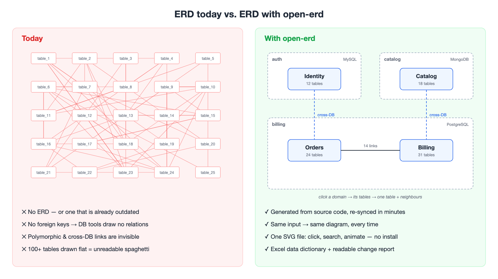
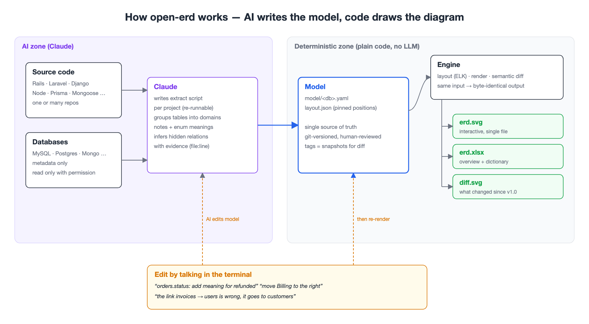
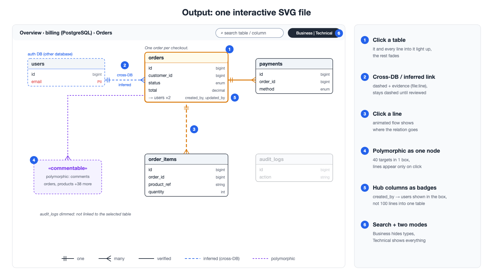
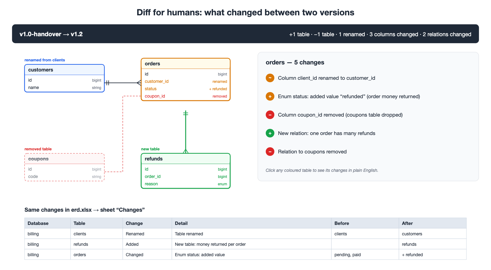

# Đề xuất: open-erd — ERD tự sinh từ source code

> Xin duyệt phát triển open-erd: plugin mã nguồn mở cho Claude Code.

## Vấn đề

ERD hầu như không có hoặc đã outdated. Schema thiếu FK, có polymorphic và quan hệ xuyên DB nên tool hiện tại không vẽ được. Hệ thống 100+ bảng thì vẽ ra không đọc nổi.

## Tính năng

**1. Sinh ERD từ source code**
- Đọc mọi stack (Rails, Laravel, Django, Node, Python…), nhiều repo, nhiều DB, nhiều loại DB (SQL + NoSQL).
- Bắt được quan hệ không có FK: polymorphic, xuyên DB, xuyên service.
- Quan hệ AI suy đoán vẽ nét đứt, kèm bằng chứng trong code, chờ người duyệt.
- Đọc DB chỉ khi user cho phép, và chỉ đọc metadata.

**2. Sơ đồ dễ đọc với 100+ bảng**
- Xem theo 3 tầng: DB → domain → bảng.
- Mỗi bảng có note công năng; enum và cột quan trọng có giải thích.
- Ký hiệu crow's foot (1-1, 1-n, n-n). Line đi vuông góc, không cắt qua bảng.
- Polymorphic gom thành 1 node. Cột dùng chung (`created_by`…) hiện thành badge, không vẽ dây.

**3. Một file SVG tương tác**

- Click bảng → highlight bảng và các line nối vào. Click line → animation chạy tới bảng đích.
- Tìm bảng/cột. Hai chế độ: Business (ẩn kỹ thuật) / Technical (đầy đủ).
- Gửi 1 file, người nhận mở xem được ngay, không cần cài gì.

**4. File Excel**
- Sheet đầu là tổng quan; các sheet sau gồm bảng, quan hệ, enum, polymorphic, danh sách cần review, thay đổi.

**5. Báo cáo thay đổi cho người không đọc code**

- So 2 phiên bản (ví dụ bản bàn giao v1.0 với hiện tại).
- Thay đổi tô màu trên sơ đồ, kèm câu mô tả dễ hiểu và sheet Excel.

**6. Chỉnh sửa bằng lời trong terminal**
- Nói với AI để sửa, không phải tạo lại từ đầu.
- Bảng mới vào đúng cụm nghiệp vụ; bố cục cũ giữ ổn định, người xem vẫn quen mắt.

**7. Ổn định và an toàn**
- Cùng dữ liệu thì kết quả luôn giống hệt nhau.
- Thông tin đã được người duyệt bị khoá, AI không ghi đè.
- Workspace ERD nằm ngoài repo code, có git riêng.
- Có chế độ ẩn bảng/cột nội bộ khi gửi cho đối tác.

**Để bản sau:** HTML, export Draw.io, lint (gợi ý thêm FK/index), tìm đường join giữa 2 bảng.

## Cần anh/chị quyết định

1. Duyệt phát triển theo phạm vi trên.
2. Đồng ý phát hành open source (license MIT) dưới account/org: ______.
3. Chọn dự án nội bộ nào để chạy thử đầu tiên.
